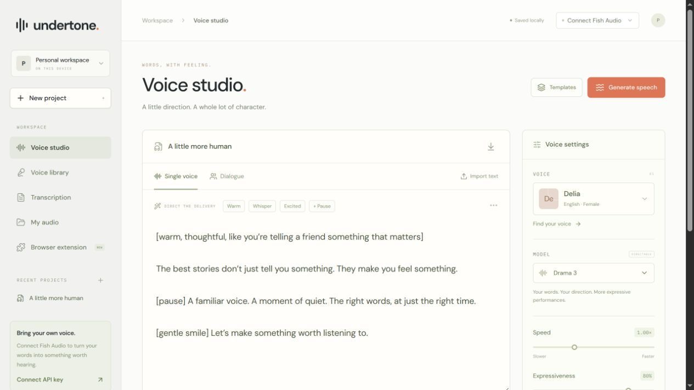

# Undertone

**A Fish Audio voice studio and browser companion.** Direct expressive speech, cast a conversation, create a permissioned voice, or turn a recording into subtitles—in one focused workspace.

[](https://github.com/Sanidhya14321/undertone/actions/workflows/ci.yml)
[](https://github.com/Sanidhya14321/undertone/releases)
[](LICENSE)

[Open Undertone](https://undertone-voice-workspace.vercel.app) · [Voice studio](https://undertone-voice-workspace.vercel.app/studio) · [Get the extension](https://undertone-voice-workspace.vercel.app/extension) · [Guides](https://undertone-voice-workspace.vercel.app/guides) · [Releases](https://github.com/Sanidhya14321/undertone/releases)



Undertone is an **independent public beta**, not an official Fish Audio product. Bring your own Fish Audio API key. Provider operations use your account's API credit; no generation credits are bundled.

## What you can do

| Workflow | Capabilities |
| --- | --- |
| Voice studio | Write scripts, direct Drama 3 delivery, adjust speed and expressiveness, and export MP3/WAV/Opus. |
| Dialogue | Cast speakers and generate a conversation with native speaker tags. |
| Voice library | Browse public and private voices, use a custom voice ID, create a private fast clone from a permissioned recording, or compare designed voice auditions. |
| Transcription | Review text and optional speaker turns; export TXT, SRT, or VTT, or open the transcript as a script. |
| Audio library | Keep actual audio takes in IndexedDB, play decoded waveforms, compare, and download. |
| Browser companion | Capture explicit text selections, listen through Fish Audio, or send a passage to the studio. |

[Speech guide](https://undertone-voice-workspace.vercel.app/guides/fish-audio-text-to-speech) · [Browser listening guide](https://undertone-voice-workspace.vercel.app/guides/read-webpages-aloud) · [Subtitle guide](https://undertone-voice-workspace.vercel.app/guides/audio-to-srt-subtitles)

## Run locally

Use **Node.js 22.x**, npm, and **Python 3** for extension packaging. `.nvmrc` selects the supported Node major.

```sh
git clone https://github.com/Sanidhya14321/undertone.git
cd undertone
npm ci
npm run dev
```

Open `http://localhost:3000`. The public site is at `/`; the workspace is at `/studio`. No deployment secret is needed. To use the provider, choose **Connect Fish Audio** in the studio and enter a key from [your Fish Audio account](https://fish.audio/app/api-keys).

```sh
npm test                          # Controlled integration and behavior tests
npm run check                     # TypeScript
npm run build                     # Extension ZIP + production website
npm run check:site -- --start      # HTTP checks against the production build
npm run check:site -- https://undertone-voice-workspace.vercel.app
npm start                         # Serve an already-built site
```

Live billable Fish Audio requests and native extension playback need a valid key and separate manual verification. Passing automated tests does not certify those provider operations.

## Install the Chrome or Edge companion

1. Download the extension ZIP from the [website](https://undertone-voice-workspace.vercel.app/extension) or a [versioned release](https://github.com/Sanidhya14321/undertone/releases).
2. Extract the archive to a folder you will keep.
3. Open `chrome://extensions` or `edge://extensions`, enable **Developer mode**, and choose **Load unpacked**.
4. Select the folder containing `manifest.json`. Open the popup, add your Fish Audio key, and save settings.
5. Select text on a webpage to capture, listen, or open it in the studio.

Chrome/Edge 124+ is required. This is an unpacked developer package, not a browser-store publication. The website and extension use separate connections. Protected browser pages and some PDF viewers require pasting instead of capture.

The published ZIP targets the public studio. For your own deployment, configure the studio URL in the popup or set `NEXT_PUBLIC_SITE_URL` before running `npm run package:extension`. Release downloads include SHA-256 checksums.

## Privacy and limits

- The studio key stays in tab memory and is forwarded through the app's same-origin proxy to Fish Audio. Reload to disconnect. It is not stored in projects or a server database.
- Extension keys use `chrome.storage.session`; non-secret settings use local extension storage. Listening calls Fish Audio directly.
- Projects use localStorage and takes use IndexedDB. They do not sync across devices, browsers, or domains. Export JSON and download audio before clearing site data.
- The extension reads explicit selections and has no browsing-history or persistent all-page permission. Studio handoff excludes the key and strips source query strings/fragments.
- Uploads are limited to **4 MB** on Vercel. Long transcription requests may need splitting.
- TXT corrections do not rewrite SRT/VTT words or timestamps. Language controls do not translate scripts; phrase-level switching is experimental.
- No application analytics or advertising scripts. Fonts are self-hosted. Hosting and Fish Audio may retain operational data under their own policies.

[Privacy details](https://undertone-voice-workspace.vercel.app/privacy) · [Troubleshooting](https://undertone-voice-workspace.vercel.app/help)

## Deploy and maintain

Import the repository as a **Next.js** project, or deploy it with the Vercel CLI. `vercel.json` declares install/build commands and the API duration. Vercel's stable production domain is used for canonical URLs and extension packaging.

For a custom domain, set `NEXT_PUBLIC_SITE_URL` to its HTTPS origin and redeploy. Optional Google/Bing ownership verification metadata is supported through the values documented in `.env.example`. No Fish Audio key belongs in deployment configuration.

The hosted project is connected to GitHub with `main` as its production branch. Version tags run the release workflow, which publishes a checksummed extension package; releasing and deploying remain separate operations.

[Architecture](docs/ARCHITECTURE.md) · [Operations and deployment](docs/OPERATIONS.md) · [Search and indexing](docs/SEO.md) · [Release process](docs/RELEASING.md) · [Roadmap](docs/ROADMAP.md)

The previous Sites/Vinext adapter remains available through `dev:sites` and `build:sites`. Native Next.js is the supported Vercel target.

## Contribute or get help

Start with [CONTRIBUTING.md](CONTRIBUTING.md), [open issues](https://github.com/Sanidhya14321/undertone/issues), or [Discussions](https://github.com/Sanidhya14321/undertone/discussions). Focused bug fixes, accessibility improvements, provider integration checks, and clear documentation are welcome.

See [SUPPORT.md](SUPPORT.md) for help channels and [CODE_OF_CONDUCT.md](CODE_OF_CONDUCT.md) for community expectations. Report vulnerabilities through [private security reporting](https://github.com/Sanidhya14321/undertone/security/advisories/new), following [SECURITY.md](SECURITY.md). Never post a key or private recording publicly.

## License

Original Undertone code is licensed under [Apache License 2.0](LICENSE). See [NOTICE](NOTICE) for attribution and third-party notices. Dependencies and fonts retain their respective licenses. This license does not grant rights to Fish Audio's service, voices, or trademarks, or to someone else's recordings.
