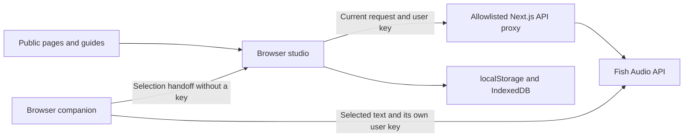

# Architecture

Undertone uses Next.js App Router, React, and TypeScript. Public pages are server-rendered/static; the studio is a client application. The public site has its own CSS and self-hosted fonts. There is no account database, cloud project sync, or application analytics.

## Boundaries

| Area | Source | Responsibility |
| --- | --- | --- |
| Public pages | `app/(public)/` | Homepage, features, extension installation, guides, help, privacy. |
| Metadata | `lib/seo.ts`, `lib/site-url.mjs` | Stable origin, page-specific metadata, safe JSON-LD. |
| Studio | `components/studio/` | Editing, provider operations, local projects, actual audio playback. |
| Request builders | `lib/studio.ts` | Provider payloads, tags, subtitle exports. |
| Proxy | `app/api/fish/[...path]/route.ts`, `lib/fish-proxy.mjs` | Fixed upstream, allowlisted methods/endpoints/model headers, request limits, cancellation, no-store and error redaction. |
| Extension | `extension/` | Explicit capture, session key, direct Fish Audio listening, studio handoff. |
| Packaging | `scripts/package-extension.mjs` | Deterministic ZIP entries, deployment-specific studio URL, license notices. |
| Verification | `tests/`, `scripts/check-site.mjs` | Controlled provider tests and real HTTP checks against a built or deployed site. |

The browser key is optionally remembered on the device, restored into React memory and forwarded per request; it is not a server environment variable. Connection validation reads the provider voice library. Generated takes save as blobs in IndexedDB, and project settings/scripts save in localStorage.

The extension uses `activeTab`, `scripting`, `contextMenus`, `storage`, `offscreen`, and `sidePanel`. Its only host permission is `https://api.fish.audio/*`. The offscreen document uses `chrome.runtime` for coordination and owns playback. Keys are not included in selection URLs. A studio handoff uses a Unicode-safe URL fragment; the studio consumes and removes it.

## Hosting limits

Vercel's request limit is 4.5 MB. The UI accepts files up to 4 MB; the proxy allows multipart overhead up to 4.25 MiB. The Node.js route has a 300-second maximum, and transcription times out before that. Long recordings must be split or compressed. There are no background-job or realtime-telephony services in this release.

## Changes that need deliberate review

Adding persistent credentials, new provider destinations, broad extension host permissions, cloud project storage, or application telemetry changes the data boundary. Update the implementation, privacy explanation, permission description, and meaningful tests together. Do not silently introduce any of these through a dependency or a marketing-only change.

## Translation boundary

`extension/translation-core.mjs` is shared between the Next.js client and extension side-panel document. It uses browser Translator/LanguageDetector APIs, never the Fish proxy, a service worker, or a cloud translation provider. Preparation uses explicit user gestures, pair availability checks, model-download progress, and cancellable jobs. Prose is segmented by paragraph/sentence; directions, speaker tags, code and URLs are protected, while language wrappers are removed. Low-confidence detection requests a manual source.

The review checkpoint preserves originals and edits before applying. Project provenance is optional, keeping older projects readable. Transcript translations create untimed speech text without changing source subtitles. URL handoffs accept legacy payloads and a version-2 allowlisted translation object, limit each text field to 20,000 characters and the encoded envelope to 384,000, strip source URL query/fragment, omit keys, and clear the consumed fragment.

The extension keeps translation drafts in session storage, target preference locally, and pending new captures separate from the reviewed draft. Side-panel model work is independent of the popup lifetime; closing the panel aborts transient jobs. Speech continues through the existing offscreen document with the reviewed text and target pronunciation language. No new host permission is needed.
